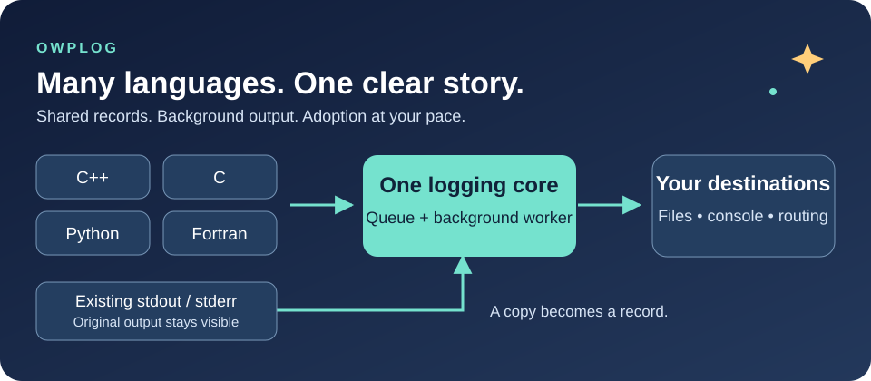
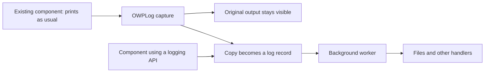

<p align="center">
  
</p>

# OWPLog • Many languages. One clear story.

**Bring your whole application into view—even the parts that only print.**

A solver in Fortran. A driver in Python. A library in C. Your application in C++.
OWPLog helps their messages tell one story, with shared output rules and useful context.

Built in C++17 for Linux applications, OWPLog sends accepted log records to a background worker.
Your components can use its logging API, keep printing as usual, or adopt it a little at a time.

[Explore the architecture](docs/ARCHITECTURE.md) · [Connect a language](docs/C_API_INTEROP_GUIDE.md) · [See a full example](examples/e2e/README.md)

## Give every component a voice

| What you need | What OWPLog brings |
| --- | --- |
| One application, several languages | Native C++ calls and a small C interface, plus Python and Fortran helpers |
| Keep work moving | Non-blocking log submission with output handled by a background worker |
| Include older components | Teed stdout and stderr capture: keep the original output and make a log copy |
| Find the right message | Levels, named loggers, filters, and source details |
| Choose where records go | Console and file handlers, plus routing based on record fields |
| Grow without a rewrite | Extend handlers, filters, and formatters in C++ |

A **log record** is a message with details such as its time, level, component name, and source.
A **handler** writes that record to a destination, such as a file or the console.

## Adoption is optional for downstream components

The application can collect output from a component without asking that component to change its code.
Ordinary stdout (normal printed output) and stderr (error output) can become log records.

Capture is **teed**: OWPLog copies the text to its original destination and also turns the text into records.
The built-in console handler skips captured records by default, so the same text is not printed again.



Start with capture. Add direct logging where richer details help.
A downstream component does not have to call OWPLog to have its printed output included.
Capture covers output written to this process's captured stdout and stderr; it does not collect every external process or separate log file.

## Speak your language

| Language | Entry point | Why use it? |
| --- | --- | --- |
| C++ | [Public API](include/owplog/owplog.h) | Configure the application and submit messages with source details |
| C | [C interface](include/owplog/c_api.h) | Submit messages through a small shared-library interface |
| Python | [Python helpers](interop/python) | Use `ctypes` and connect Python's standard `logging` tools |
| Fortran | [Fortran module](interop/fortran/owplog_logger_mod.f90) | Call the C interface through `ISO_C_BINDING` |

The C interface lets components submit messages and register named loggers.
It also accepts optional source, language, and rank details. A rank is a process number used in parallel jobs.
Application setup stays with the host; the C interface does not expose initialization or reconfiguration.
When no handlers exist, C-interface calls fall back to normal stdout or stderr output.

See the [interop guide](docs/C_API_INTEROP_GUIDE.md) for linking, library loading, and language examples.

## Keep the work moving

Accepted API messages enter a thread-safe queue. A background worker formats them and sends them to handlers.
The calling code does not wait for each queued message to be written to a file.

“Non-blocking” describes that separation from output work. Calls still copy data, run checks, and use locks;
this is not a lock-free or hard real-time promise. Captured printing and fallback console output can wait on operating-system I/O.

## Try it in C++

```cpp
#include "owplog/owplog.h"

int main() {
    owplog::LoggerConfigurationArguments settings;
    settings.filename = "app.log";
    settings.level = owplog::LogLevel::Debug;
    owplog::basicConfig(settings);

    OWPLOG_LOG_INFO_MSG("Application ready");
    owplog::info("Step complete", "solver", OWPLOG_SOURCE_LOCATION);

    owplog::shutdown();
}
```

Let the host call shutdown after its components finish logging, so the worker can finish queued output.

For a C component, a message can be as small as:

```c
#include "owplog/c_api.h"

void report_ready(void) {
    owplog_logger_log(OWPLOG_LOG_INFO, "c.component", "Component ready");
}
```

## Build and explore

Use CMake 3.20 or newer and a compiler with C++17 support. The current stream capture uses POSIX
system calls and targets Linux environments such as RHEL 8+ and Rocky Linux.

```bash
cmake -S . -B build -DOWPLOG_BUILD_TESTS=ON -DOWPLOG_BUILD_SHARED_C_API=ON
cmake --build build --config Release
ctest --test-dir build --output-on-failure
```

Tests use GoogleTest; CMake downloads it if it is not installed.
The [cross-language demos](examples/e2e/README.md) explain their extra language and build needs.
For a smaller build, set `OWPLOG_BUILD_E2E_EXAMPLES=OFF`.

Prefer a helper? Run `bash scripts/build.sh` to build, or `bash scripts/test.sh` to build and test.
Both accept `--help` and `--interactive`.

Generate a searchable API reference with `bash scripts/docs.sh`. See the
[documentation guide](docs/DOCUMENTATION.md) for tools, theme details, and the
workflow that generates the site after a pull request is merged.

## Make the output yours

Choose which levels to keep, filter by message text, and set a shared format.
Records can include time, level, component, source file and line, thread, process, language, and rank.
Direct calls can supply details that plain printed text does not carry.

For example:

```text
[%(asctime)s] %(levelname)s %(name)s %(filename)s::%(lineno)d - %(message)s
```

See [record fields and format tokens](include/owplog/log_record.hpp).
The [architecture guide](docs/ARCHITECTURE.md) shows how filters, formatters, handlers, and the router fit together.

## What's next?

- **A configuration system.** Make output choices easier to manage from a file. The repository has a
  [prototype design](docs/CONFIGURATION_ENGINE.md); a finished configuration system is future work.
  Current applications configure logging through C++.
- **Hopefully, an MPI handler.** MPI is a way for processes in a parallel job to exchange messages.
  The goal is to send log records to specific branches of a parallel application, with selected
  processes or ranks as destinations. This is an idea for future work, not a shipped feature.
  Current rank metadata and local record routing do not provide MPI transport.

**Start with the output you already have. Add richer records when you're ready.**
