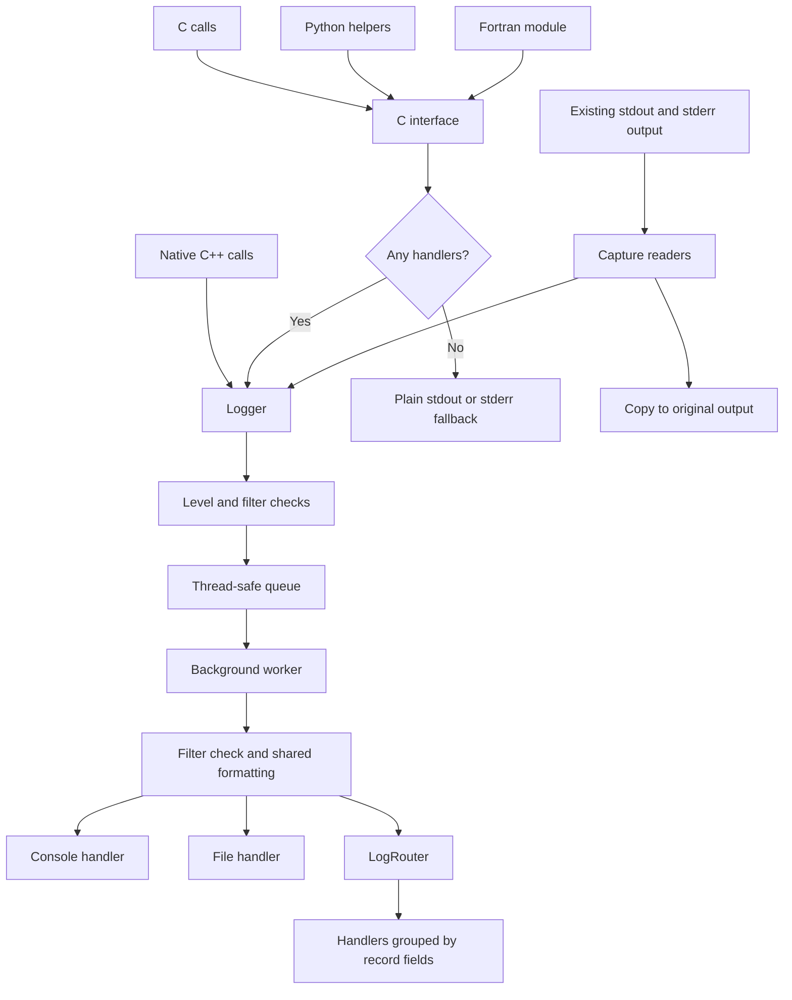
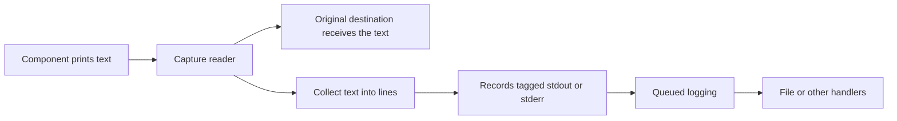

# OWPLog architecture: one story from many components

**Bring messages together without making every team change its code.**

OWPLog gives a mixed-language application a common way to collect and write messages.
The host application chooses the output rules. Components can send rich log records or keep
writing normal text. That makes it useful for both new code and code you cannot easily change.

## Two ways in. One shared core.

Direct logging supplies a message and details such as its level, component, source, language, or rank.
Capture brings existing printed output into the same core. Both paths create records that handlers can write.

The built-in console handler skips captured records by default.
The original text is already visible through the capture copy.

## Why this design helps adoption

| Design choice | What it means for a team |
| --- | --- |
| Several language entry points | Keep the languages that fit your work |
| Shared records | Search and compare messages with a common set of details |
| Background output | Keep file-writing work out of normal message submission |
| Capture with an original-output copy | Include existing components while keeping their printed output visible |
| Host-owned setup | Keep output choices in the application instead of spreading them across libraries |
| Replaceable output parts | Add a destination or format without changing every caller |

A component that only prints can stay that way. A component that needs source lines or rank details
can use the API. Teams can make that choice on their own schedule.

## Follow a message

1. **Create a record.** A direct call supplies text and optional details. Capture readers build
   records from non-empty printed lines and mark them as captured stdout or stderr.
2. **Check whether to keep it.** The logger checks its level and filters before queueing.
3. **Hand off the work.** The caller submits the record to a thread-safe queue.
4. **Prepare the output.** The worker checks filters and formats each accepted record.
5. **Write to destinations.** Each handler checks its own rules and writes the output.

A formatter turns a record into readable text. A filter decides whether to keep a record.
A handler writes it. These are extension points, so an application can add its own behavior.

### Fast submission, honest limits

The queued API path supports non-blocking operations by moving output work to a worker thread.
It still uses locks, allocates memory, copies text, and runs checks on the calling thread.
Custom filters can add work there too.

One worker handles the queued output. A slow handler can delay later records, and a backlog needs memory.
Captured printing and direct fallback output still depend on operating-system I/O.
This design separates application work from queued output; it does not promise fixed response times.

Have the host stop message producers before calling shutdown. Shutdown stops capture, finishes queued
processing, and flushes handlers. Do not treat a normal logging call as proof that a record has reached disk.

## Keep printed output useful

Stdout is a program's normal text output. Stderr is its error output.
OWPLog's capture reads these streams in the current process and does two jobs:

This copy behavior is called a **tee**. No Linux command knowledge is needed: one message reaches
its original destination, and another copy becomes a record.

Complete non-empty lines become records; a final partial line is submitted when capture ends.
Printed text does not automatically reveal the component's source file, language, or rank.
Use direct logging when those details matter.

In the current implementation, logger startup starts stdout and stderr capture.
The public logger does not offer capture switches; file-based capture controls belong to the
configuration work still ahead. Downstream components can keep printing without adopting the API.

See [capture.cpp](../src/core/capture.cpp) for the copy and line handling, and
[console_handler.cpp](../src/handlers/console_handler.cpp) for captured-record suppression.

## Connect languages without sharing setup duties

The native C++ API configures and uses the logger.
The small C interface provides message submission, named logger handles, and optional details.
Python uses that interface through `ctypes`; Fortran uses `ISO_C_BINDING`.

The C interface checks for handlers. If there are none, it writes a simple message to stdout or stderr.
That fallback does not preserve all record details and is not queued background output.
The default logger creates a console handler, so fallback specifically applies when the handler list is empty.

For a host and its components to share output rules, they must reach the same logger instance.
Follow the [interop guide](C_API_INTEROP_GUIDE.md) for shared-library loading and linking.
Language entry points alone do not join separate processes into one logging service.

## Route records where they help

A file handler writes to a file. A console handler writes to the console.
`LogRouter` selects or creates child handlers based on chosen record fields.

For example, grouping by component name can send solver records to one file and driver records to another.
A `FileHandlerFactory` creates the file handlers using a filename pattern.
This is local routing inside the process.

The same extension model gives future destinations a place to fit.
Today, a rank field describes a record; it does not send that record over a network.

## A path toward larger jobs

**Current building blocks:** language entry points, queued processing, stdout/stderr capture,
filters, formatters, console and file handlers, and local routing.

**Future work:**

- **Configuration system:** turn a file into clear output choices. A
  [prototype document](CONFIGURATION_ENGINE.md) describes the direction, but its proposed API
  is not a finished, built configuration system.
- **Possible MPI handler:** send records to specific branches of a parallel application, such as
  selected processes or ranks. MPI lets parallel processes exchange messages. This hoped-for
  extension still needs decisions about destinations, ordering, shutdown, and failure handling.

Neither feature is required to start using the current logging core.

## Find the building blocks

| Area | Source |
| --- | --- |
| C++ entry points | [owplog.h](../include/owplog/owplog.h) |
| C entry points | [c_api.h](../include/owplog/c_api.h) |
| Logger and background worker | [logger.cpp](../src/core/logger.cpp) |
| Shared application logger | [root_logger.cpp](../src/core/root_logger.cpp) |
| Record details and format tokens | [log_record.hpp](../include/owplog/log_record.hpp) |
| Local routing and file factory | [router.h](../include/owplog/handlers/router.h) |
| Python and Fortran helpers | [interop](../interop/) |
| Full application examples | [cross-language demos](../examples/e2e/README.md) |

[Back to the README](../README.md)
